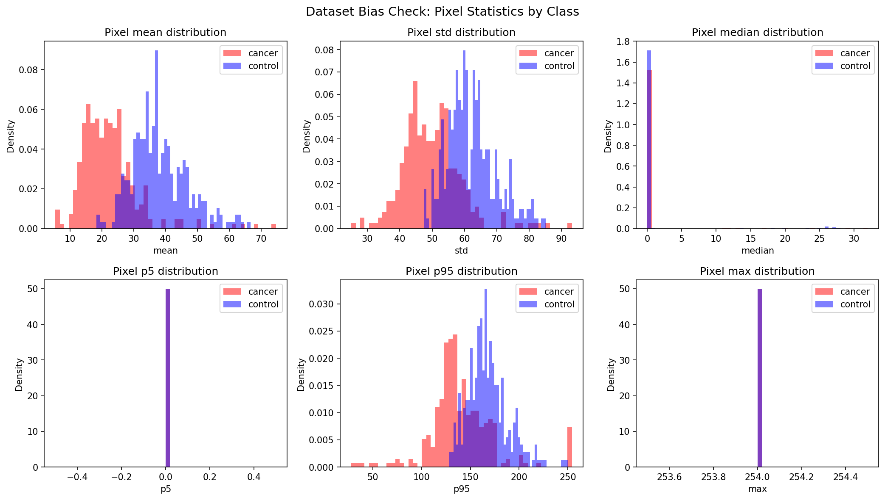
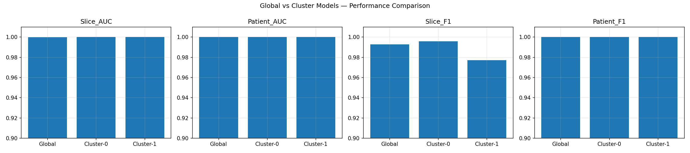

# Multimodal Pancreatic Cancer Detection

Multimodal Pancreatic Cancer Detection is a bias-aware research repository for pancreatic cancer detection using CT imaging and urinary biomarkers. It started as an MSc dissertation (2D ResNet50 CT classifier, seven-feature biomarker MLP, exploratory fusion) and is now a Q1 paper: an end-to-end audit of measured confounding and deployment in the largest public PDAC CT cohort (PANORAMA), with the same confound audit applied to the urinary biomarker cohort and an honest treatment of fusion between unpaired cohorts.

**Documentation index: [`docs/README.md`](docs/README.md)** — every doc, what it answers, and where the data and models live.

## Current Status (2026-10-27): all pre-registered experiments complete, write-up next

The Q1 work uses PANORAMA (2,238 contrast-enhanced CTs; 1,964 Dutch scans for training, 194 MSD + 80 NIH held out as external tests), 3D nnU-Net models on pancreas-region crops, and a 2.5D classifier for the mitigation panel. Dutch detection metrics are scored on the patient-disjoint evaluation set: the 1,939 patients with a single examination (`tools/eval_cohort.py`); the 25 scans of the 11 repeat-examination patients stay in training only.

- **The confound is real in the data:** scanner manufacturer alone predicts PDAC with AUROC 0.70 (Philips scans are 75% PDAC, Siemens/Toshiba ~19%).
- **The 3D model exploits it only weakly:** confound tax +0.028 AUROC [+0.007, +0.051], no penalty when a whole manufacturer is held out, external MSD AUROC 0.82 [0.76, 0.88].
- **It survives real deployment:** cropping from a predicted pancreas mask costs <= 0.012 AUROC when the segmenter never fails; TotalSegmentator used as documented (`roi_subset pancreas`) silently fails on 6 % of scans (mostly cancer and Siemens scans), costing 0.087 AUROC and raising the tax to +0.044; requesting the neighbouring organs fixes every failure. Figure: `figures/panorama/deployment_arms.png`.
- **A stronger 2.5D classifier uses the confound more:** Dutch AUROC 0.928 vs 0.788 (DeLong p<0.001) but tax +0.056 and a tie with the 3D model on external MSD (0.827 vs 0.823).
- **Debiasing does not beat tuned ERM on the real confound:** group-balanced sampling, DFR, GRL and MAE pretraining lower no tax significantly and all cost accuracy (MAE raises the tax, +0.027 [+0.013, +0.043]); yet the same methods remove 64–90 % of a deliberately planted shortcut, so the methods work and the real confound is weakly exploitable. Figure: `figures/panorama/mitigation_panel.png`.
- **The urinary biomarker cohort is confounded too:** all healthy controls come from one site; site alone predicts PDAC at AUROC 0.68, site tax +0.062 [+0.027, +0.098].
- **Fusion of unpaired cohorts:** its gain depends entirely on the untestable error correlation between the tests (0.917 at independence -> 0.884 = urine alone); pseudo-paired fusion reports the independence case. Urine triage before CT would avoid ~49 % of CTs at 1 % prevalence. Figure: `figures/panorama/fusion_triage.png`.
- **The thesis's 0.9999 is the data:** our own pipeline retrained on the thesis two-source set reaches 0.996 (vs 0.745 on clinical data at the same training size) and crop statistics alone separate its two collections (0.872).
- **Next:** the write-up (MedIA / npj Digital Medicine); framing and prior work in [`docs/literature_novelty_check.md`](docs/literature_novelty_check.md).

Full results: [`docs/deployment_and_mitigation_design.md`](docs/deployment_and_mitigation_design.md) (status section) and [`docs/modeling_pipeline.md`](docs/modeling_pipeline.md); plan: [`docs/q1_readiness_and_gaps.md`](docs/q1_readiness_and_gaps.md).

## Thesis-Era Workflow (2025)

The sections below describe the original dissertation pipeline. Its CT headline (AUC 0.9999) is a dataset-of-origin artifact — the motivating case for the Q1 work, not a performance claim.

## What It Does

- detects and mitigates cross-dataset shortcut risk in CT slices before CT model training
- trains a ResNet50 CT classifier with slice-level and patient-level evaluation
- trains a urinary biomarker MLP on the seven-feature panel used in the dissertation
- evaluates decision-level and feature-level fusion with multi-seed repeats and label-mismatch controls
- exports tracked summaries, comparison tables, and curated figures for thesis and research reporting

## Research Flow

1. Prepare CT and biomarker inputs with the preprocessing scripts when fresh local preprocessing is needed.
2. Run CT bias checks and iterative mitigation.
3. Apply orientation correction, body segmentation, and cropping for CT slices.
4. Train and evaluate the CT ResNet50 model.
5. Train and evaluate the biomarker MLP.
6. Run exploratory fusion experiments with negative controls.
7. Export final summaries, comparison tables, and figures.

## Visual Snapshot

### Bias Mitigation Diagnostic

### Comparative Model Summary

## Thesis Result Snapshot

The thesis summary in `reports/final_summary.json` reports:

- CT model: ResNet50 (global)
- CT slice-level AUC: 0.9999
- CT patient-level AUC: 1.0000
- Biomarker model: MLP (64-32)
- Biomarker test AUC: 0.9439

Those numbers should be read carefully:

- the biomarker branch reproduces the published panel, but its cohort has a site confound (all healthy controls from one site; site tax +0.062, see `reports/biomarker_confound.csv`)
- the thesis CT result is confounded: cancer and control scans came from different source datasets, so the classifier could separate the datasets rather than the disease
- fusion cannot be evaluated at patient level because CT and biomarker cohorts are not patient-paired; the Q1 work treats it as a dependence-sensitivity simulation (`reports/fusion/`)

## Documentation

See **[`docs/README.md`](docs/README.md)** for the full index. Most-used:

- [`docs/q1_readiness_and_gaps.md`](docs/q1_readiness_and_gaps.md) — living Q1 plan
- [`docs/modeling_pipeline.md`](docs/modeling_pipeline.md) — 3D nnU-Net pipeline and results
- [`docs/deployment_and_mitigation_design.md`](docs/deployment_and_mitigation_design.md) — pre-registered design and every Q1 result (status section at the top)
- [`docs/literature_novelty_check.md`](docs/literature_novelty_check.md) — what is new vs prior work, per contribution
- [`docs/data_layout.md`](docs/data_layout.md) — where data, models and results live
- [`ROADMAP.md`](ROADMAP.md), [`DEVLOG.md`](DEVLOG.md), [`DEAD_ENDS.md`](DEAD_ENDS.md), [`docs/architectural_decision_records/`](docs/architectural_decision_records/README.md)
